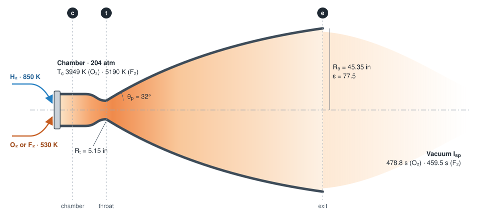
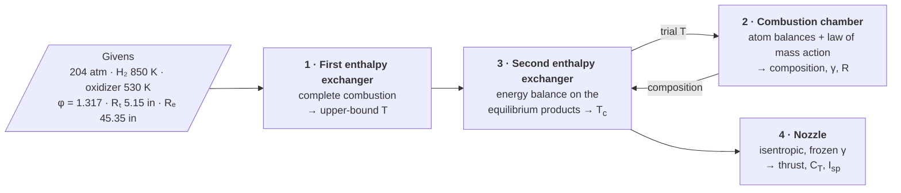
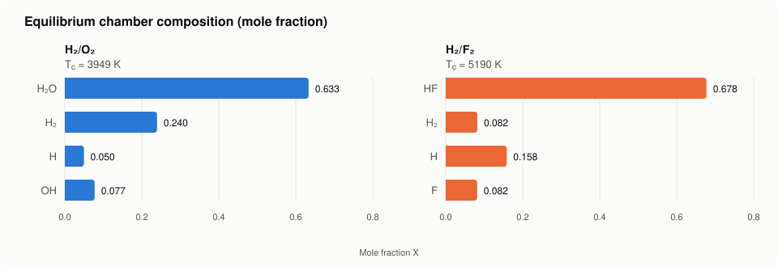

<div align="center">

# rs25-gone-fluorine

**A first-principles performance model of the Space Shuttle Main Engine (RS-25), from propellant enthalpy and chemical equilibrium to nozzle thrust and specific impulse, and the same engine run on fluorine.**

[](https://www.python.org/)
[](LICENSE)
[](https://janaf.nist.gov/)
[](docs/SSME_writeup.md)



<sub>The RS-25 thrust chamber and bell nozzle drawn to scale from the givens, with the stations used throughout the code: chamber (c), throat (t) and exit (e).</sub>

</div>

---

## Overview

The RS-25 burns liquid hydrogen with liquid oxygen at about 3000 psi and expands the exhaust through a 77.5 : 1 bell nozzle. This repository models its thrust chamber from the thermo tables up: it finds how hot the chamber gets once the products partly break apart, what the gas is made of, and what thrust and specific impulse the nozzle delivers. Then it asks what happens if the oxidizer is swapped for fluorine.

Both engines go through the same four steps. Steps 2 and 3 are solved together, because the composition depends on temperature and the temperature depends on the composition.



| Step | H₂/O₂ | H₂/F₂ |
|---|---|---|
| 1 · First enthalpy exchanger | `FEE` | `FEE_F` |
| 2 · Combustion chamber | `OCC` (H₂O, H₂, H, OH) | `FCC` (HF, H₂, H, F) |
| 3 · Second enthalpy exchanger | `ChamberTemperature` | `FluorineChamberTemperature` |
| 4 · Nozzle | `OxNozzlePerf` | `OxNozzlePerf` |

## Design point at a glance

| | Parameter | H₂/O₂ | H₂/F₂ |
|---|---|:-:|:-:|
| **Inputs** | Chamber pressure | 204 atm | 204 atm |
| | Equivalence ratio φ | 1.317 | 1.317 |
| | Oxidizer/fuel mass ratio | 6.02 | 14.3 |
| | Injection temperatures (H₂ / oxidizer) | 850 K / 530 K | 850 K / 530 K |
| | Nozzle area ratio ε | 77.5 | 77.5 |
| **Chamber** | Complete-combustion temperature | 4617 K | 7107 K |
| | Equilibrium temperature T<sub>c</sub> | **3949 K** | **5190 K** |
| | Mixture molar mass | 13.26 g/mol | 15.43 g/mol |
| | γ (frozen) | 1.199 | 1.319 |
| **Nozzle** | Mass flow | 457.9 kg/s | 445.7 kg/s |
| | Exit Mach number | 4.70 | 5.70 |
| | Vacuum thrust | 2.151 MN | 2.009 MN |
| | Vacuum I<sub>sp</sub> | **478.8 s** | **459.5 s** |
| | Sea-level I<sub>sp</sub> | 384.8 s | 362.8 s |

For reference, the real RS-25 is rated at about 2.28 MN and 452 s in vacuum at 109% power. The model sits higher mainly because the givens inject the propellants warm and the nozzle has no losses.

<div align="center">

</div>

The fluorine chamber runs 1240 K hotter, yet its specific impulse comes out lower. About a quarter of its gas is H and F atoms, and the nozzle model keeps the composition frozen, so the energy those atoms would release by recombining in the nozzle is never recovered. The fluorine result is therefore a lower bound; see [the write-up](docs/SSME_writeup.md#fluorine).

## Validation

| Check | Model | Reference |
|---|---|---|
| H₂/O₂ chamber temperature | 3949 K | 3881 K, Cantera equilibrium at the same inputs (the model leaves out O and O₂) |
| H₂/O₂ mixture molar mass | 13.26 g/mol | 13.22 g/mol, Cantera |
| H₂/F₂ chamber temperature | 5190 K | 5197.5 K, the same method run on NIST-JANAF data for every species |
| H₂/O₂ vacuum I<sub>sp</sub> | 478.8 s | 452 s, RS-25 rating (real engine: cryogenic propellants, real nozzle losses) |

`make test` also checks the physics directly on every run: atoms are conserved, both equilibrium constants match the Gibbs tables, both energy balances close to within 1 J/mol, dissociation lowers the temperature, and the thrust equations hold.

## Quick start

```bash
git clone https://github.com/Carmeisel101/rs25-gone-fluorine.git
cd rs25-gone-fluorine
make setup     # creates .venv and installs requirements.txt
make           # runs both engines and prints the results
```

| Command | What it runs |
|---|---|
| `make` | `SSMEMain.py`: both engines, chamber through nozzle, vacuum and sea level |
| `make test` | Regression checks: saved results plus physics identities for both engines |
| `make figures` | Redraws `docs/rs25-schematic.svg` and `docs/composition.svg` from the model |
| `make clean` / `make distclean` | Removes `__pycache__`, and also `.venv` |
| `make help` | Lists the targets |

Without `make`: `pip install -r requirements.txt`, then `python SSMEMain.py`. Requires Python 3.11 or newer; numpy, pandas and scipy are the only dependencies.

> [!NOTE]
> The course tables cover H₂, O₂, H₂O, H, OH, F₂ and HF. The fluorine chamber also needs atomic fluorine, the Gibbs energy of HF, and hydrogen atoms above 5000 K, so those come from the [NIST-JANAF tables](https://janaf.nist.gov/). Six enthalpy entries in the course tables were typos that broke the slope set by c<sub>p</sub>, and have been corrected; the [write-up](docs/SSME_writeup.md#data) lists them.

## Write-up

[**docs/SSME_writeup.md**](docs/SSME_writeup.md) has the full derivation: propellant enthalpies with the real-gas correction, the equilibrium equations for both engines, the energy balances, the nozzle relations, and the results.

## Repository layout

```text
rs25-gone-fluorine/
├── SSMEMain.py        # givens, and the run of both engines
├── exchanger.py       # enthalpy exchangers, chamber equilibria, nozzle
├── Iterater.py        # thermo-table lookups, species enthalpies, Mach solver
├── tables/            # thermo tables (course data + NIST-JANAF additions)
├── tests/             # regression checks
├── docs/              # write-up, README graphics and the script that draws them
├── Makefile
└── requirements.txt
```

## Acknowledgements

Built from course data provided by Dr. Rodney Bowersox. Thermochemical data for atomic fluorine, HF Gibbs energies and high-temperature atomic hydrogen are from the NIST-JANAF Thermochemical Tables. The H₂/O₂ equilibrium was cross-checked with [Cantera](https://cantera.org/).

## License

[MIT](LICENSE) © 2022 Carlos Meisel
