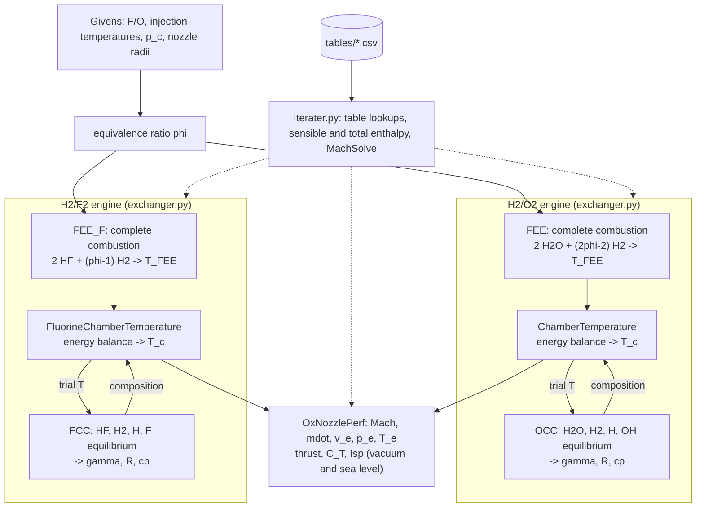

# Space Shuttle Main Engine (SSME) performance model

A performance model of the Space Shuttle Main Engine, built from the course data of Dr. Rodney Bowersox. It computes the chamber temperature and equilibrium composition from the propellant energy balance, then the ideal nozzle performance (thrust, $C_{T}$, $I_{sp}$) in vacuum and at sea level. It runs two engines:

- **H₂/O₂**, the SSME itself.
- **H₂/F₂**, the same engine with fluorine as the oxidizer, at the same equivalence ratio, injection temperatures, chamber pressure and nozzle.

The full write-up, with every equation and both sets of results, is in [docs/SSME_writeup.md](docs/SSME_writeup.md).

<div align="center">

| Combustion Chamber Data | |
|--------------------------| ----|
| Fuel | Hydrogen |
| Oxidizer | $O_{2}$ (and $F_{2}$ for the fluorine variant) |
| Fuel/oxidizer mass ratio, H₂/O₂ | 0.166 |
| Equivalence ratio $\phi$ (both engines) | 1.317 |
| Hydrogen injection temperature | 850 K |
| Oxidizer injection temperature | 530 K |
| Combustion chamber pressure | 204 atm |

| Nozzle Geometry | |
|--------------------------| ----|
| $R_{t}$ | 5.15 in |
| $R_{e}$ | 45.35 in |
| $\theta_{p}$ | 32.00 deg (not used by the ideal-nozzle model) |

| Results | H₂/O₂ | H₂/F₂ |
|---|---|---|
| Chamber temperature | 3949 K | 5190 K |
| Mass flow | 457.9 kg/s | 445.7 kg/s |
| Vacuum $I_{sp}$ | 478.8 s | 459.5 s |
| Sea-level $I_{sp}$ | 384.8 s | 362.8 s |

</div>

## Running it

Requires Python 3.11+ (tested on 3.15).

```bash
make setup   # create .venv and install requirements.txt
make         # run the model (SSMEMain.py)
make test    # regression checks
```


## Oxygen First Enthalpy Exchanger
We begin by computing the equivalence ratio $\phi$, the fuel/oxidizer ratio divided by its stoichiometric value. For $2H_{2} + O_{2} \rightarrow 2H_{2}O$ the moles of $H_{2}$ per mole of $O_{2}$ are $\Phi = (F/O)\,\hat{m}_{O_{2}}/\hat{m}_{H_{2}} = 2.635$, so $\phi = \Phi/2 = 1.317$ and the mixture is fuel-rich.

Next we calculate the enthalpy of each injected propellant, including a real-gas correction for the high chamber pressure:

<div align="center">

$\Delta \hat{h_{i}} =  \hat{h_{H_{2}}}(850K) -  \hat{h_{H_{2}}}(298K) + \hat{R}T^2 \int_{p_{f}}^{p_{i}} \frac{1}{p}  \frac{-\hat{b} p}{\hat{R}T^2} dp|_{T_i}$

</div>

Where $\hat{b}$ is read from a table developed in `exchanger.py`. $\Delta \hat{h_{i}}$ is calculated for both hydrogen and oxygen. Once we calculate $\Delta \hat{h_{i}}$ for each, we then calculate the enthalpy of the mixture:

<div align="center">

$\Delta \hat{h_{mix}} = \Phi \Delta \hat{h_{H_{2}}} + \Delta \hat{h_{O_{2}}}$

</div>

With $\Phi = 2\phi$ moles of $H_{2}$ per mole of $O_{2}$, complete combustion (no dissociation) gives:

<div align="center">

$O_{2} + \Phi H_{2} \rightarrow 2H_{2}O + (\Phi-2)H_{2}$

</div>

The energy available to heat the products is the propellant enthalpy plus the heat released forming two moles of water:

<div align="center">

$\Delta \hat{h}_{total} = \Phi \Delta \hat{h}_{H_{2}} + \Delta \hat{h}_{O_{2}} - 2\Delta \hat{h}_{f,H_{2}O}^{298}$

</div>

The first estimate of the chamber temperature, $T_{FEE}$, is the single temperature at which the products absorb exactly that energy, found with `scipy.optimize.brentq`:

<div align="center">

$2\left[\hat{h}_{H_{2}O}(T_{FEE}) - \hat{h}_{H_{2}O}(298)\right] + (\Phi-2)\left[\hat{h}_{H_{2}}(T_{FEE}) - \hat{h}_{H_{2}}(298)\right] = \Delta \hat{h}_{total}$

</div>

This gives $T_{FEE} \approx 4617$ K. Because it ignores dissociation it is an upper bound; the chamber temperature itself comes from the second enthalpy exchanger below.

## Oxygen - Combustion Chamber

For the Combustion Chamber we wil using the two sub-reactions:

<div align="center">

$H_{2}O \rightarrow OH+H$

$H_{2}\rightarrow 2H$

</div>

From here we are to calculate the Gibbs Free Energy of each species.

For $H_{2}\rightarrow 2H$

<div align="center">

$\Delta G_{H_{2}} = 2(\bar{g_{H}} -\bar{g_{H_{2}}})$

</div>

For $H_{2}O \rightarrow OH+H$

<div align="center">

$\Delta G_{H_{2}O} = \bar{g_{H}} + \bar{g_{OH}} - \bar{g_{H_{2}O}}$

</div>

Where $\bar{g_{fh}}$ is the Gibbs Free Energy of formation of $H_{2}$, $\bar{g_{foh}}$ is the Gibbs Free Energy of formation of OH, and $\bar{g_{fh_{2}o}}$ is the Gibbs Free Energy of formation of $H_{2}O$. These values are read from the `Iterater.py` file.

### Law of Mass Action
Looking at For $H_{2}O \rightarrow OH+H$:

<div align="center">

| Species | $\nu_{(i)} '$ | $\nu_{(i)} "$ | $\nu_{(i)} " - \nu_{(i)} '$ |
|---------|-------|-------|---------------|
| $H_{2}O$ | 1 | 0 | -1 |
| $OH$ | 0 | 1 | 1 |
| $H$ | 0 | 1 | 1 |

</div>

We know that:

<div align="center">

$K_{n} = \prod_{n=1}^{N_{s}} X_{(n)}^{(\nu_{(i)} " - \nu_{(i)} ')} = (\frac{p}{p^{ * }})^{- \sigma_{v}} K_{p}$

</div>

Where; 

<div align="center">

$\sigma_{v} = \sum_{n=1}^{N_{s}} \nu_{(i)} " - \nu_{(i)} '$

$K_{p} = e^{- \frac{\Delta G}{\hat{R}T}}$

$\Delta G = \sum_{n=1}^{N_{s}} (\nu_{(i)} " -\nu_{(i)}') \bar{g}_{f(n)}$

</div>

We can then solve for $K_{n}$:

<div align="center">

$K_{H_{2}O \rightarrow OH+H} = (\frac{204 atm}{1 atm})e^{- \frac{\Delta G_{H_{2}O}}{\hat{R}T_{c}}}$

$K_{H_{2}\rightarrow 2H} = (\frac{204 atm}{1 atm})e^{- \frac{\Delta G_{H_{2}}}{\hat{R}T_{c}}}$

</div>

Here we know that the fuel is $H_{2}$ therefore the mass of the fuel is 2.02 $\frac{g}{mol}$ and the mass of the oxidizer is $m_{oxidizer} =\frac{2.02}{\phi}$. And $l = \frac{m_{oxidizer}}{2 m_{O_2}}$. Once we have $l$ we re-visit the Chemistry Problem by solving the Atom Balance:

<div align="center">

$H_{2} +l O_{2} \rightarrow N_{H_{2}O}H_{2}O +N_{H_{2}}H_{2} + N_{H}H +N_{OH}OH$

$H_{2}: 2 = 2N_{H_{2}O} + 2N_{H_{2}} + N_{H} + N_{OH}$

$O_{2}: 2l = N_{H_{2}O} + N_{OH}$

</div>

Where $N_{H_{2}O}$, $N_{H_{2}}$, $N_{H}$, and $N_{OH}$ are the number of moles of each species. That is 4 unknowns with only 2 atom-balance equations, so the Law of Mass Action supplies the other two. The mole fractions use the full total:

<div align="center">

$X_{(i)} = \frac{N_{(i)}}{N_{Total}}, \quad N_{Total} = N_{H_{2}O} + N_{H_{2}} + N_{H} + N_{OH}$

$K_{H_{2}O \rightarrow OH+H} = \frac{X_{H} X_{OH}}{X_{H_{2}O}} = \frac{N_{H}N_{OH}}{N_{H_{2}O} N_{Total}}$

</div>

Similarly for the $H_{2}\rightarrow 2H$ Reaction:

<div align="center">


| Species | $\nu_{(i)} '$ | $\nu_{(i)} "$ | $\nu_{(i)} " - \nu_{(i)} '$ |
|---------|-------|-------|---------------|
| $H_{2}$ | 1 | 0 | -1 |
| $H$ | 0 | 2 | 2 |

$K_{H_{2}\rightarrow 2H} = \frac{X_{H}^{2}}{X_{H_{2}}} = \frac{N_{H}^{2}}{N_{H_{2}} N_{Total}}$

</div>

This gives 4 coupled equations in 4 unknowns:

<div align="center">

$2 = 2N_{H_{2}O} + 2N_{H_{2}} + N_{H} + N_{OH}$

$2l = N_{H_{2}O} + N_{OH}$

$K_{H_{2}O \rightarrow OH+H} = \frac{N_{H}N_{OH}}{N_{H_{2}O} N_{Total}}$

$K_{H_{2}\rightarrow 2H} = \frac{N_{H}^{2}}{N_{H_{2}} N_{Total}}$

</div>

The code solves them with `scipy.optimize.fsolve` in terms of $\ln N_{(i)}$, which keeps every mole number positive, starting from complete combustion ($N_{H_{2}O} = 2l$, $N_{H_{2}} = 1 - 2l$). At the chamber temperature $T_{c}$ (see below) this gives $N_{H_{2}O} = 0.6763$, $N_{H_{2}} = 0.2559$, $N_{H} = 0.0530$, $N_{OH} = 0.0827$.

We can then solve for $N_{H_{2}O}$, $N_{H_{2}}$, $N_{H}$, and $N_{OH}$:

<div align="center">

| Species | $N_{(i)}$ | $X_{(i)}$ | $m_{(i)}$ | $Y_{(i)}$ | $\hat{c_{p}}_{(i)}$ | $c_{p_{(i)}}$ | $Y_{(i)}c_{p}$ |
|---------|-------|-------|---------------|-------|-------|---------------|-------|
| $H_{2}O$ | $N_{H_{2}O}$ | $X_{H_{2}O} = \frac{N_{H_{2}O}}{N_{Total}}$ | $\hat{m} N_{H_{2}O}$ | $\frac{\hat{m}}{m_{(i)}}$ | $\hat{c_{p}} (T_{c})$ | $\frac{\hat{c_{p}}}{\hat{m}}$ | $Y_{H_{2}O}c_{p}$ |
| $H_{2}$ | $N_{H_{2}}$ | $X_{H_{2}} = \frac{N_{H_{2}}}{N_{Total}}$ | $\hat{m} N_{H_{2}}$ | $\frac{\hat{m}}{m_{(i)}}$ | $\hat{c_{p}} (T_{c})$ | $\frac{\hat{c_{p}}}{\hat{m}}$ | $Y_{H_{2}}c_{p}$ |
| $H$ | $N_{H}$ | $X_{H} = \frac{N_{H}}{N_{Total}}$ | $\hat{m} N_{H}$ | $\frac{\hat{m}}{m_{(i)}}$ | $\hat{c_{p}} (T_{c})$ | $\frac{\hat{c_{p}}}{\hat{m}}$ | $Y_{H}c_{p}$ |
| $OH$ | $N_{OH}$ | $X_{OH} = \frac{N_{OH}}{N_{Total}}$ | $\hat{m} N_{OH}$ | $\frac{\hat{m}}{m_{(i)}}$ | $\hat{c_{p}} (T_{c})$ | $\frac{\hat{c_{p}}}{\hat{m}}$ | $Y_{OH}c_{p}$ |


</div>

Now to calculate $c_{p}$ we sum the $Y_{(i)}c_{p}$ for each species:

<div align="center">

$c_{p} = \sum_{i} Y_{(i)}c_{p}$

$m_{(total)} = \sum_{i} X_{(i)}m_{(i)}$

$X_{(i)} = \frac{N_{(i)}}{N_{Total}}, \quad N_{Total} = N_{H_{2}O} + N_{H_{2}} + N_{H} + N_{OH}$

</div>

We perform this step to calculate the gas constant $R$:

<div align="center">

$R = \frac{\hat{R}}{m_{(total)}}$

$c_{v} = c_{p} - R$

</div>

Resulting in use getting a gamma of:

<div align="center">

$\gamma = \frac{c_{p}}{c_{p} - \frac{\hat{R}}{\sum_{i} X_{(i)}m_{(i)}}} = \frac{c_{p}}{c_{p} - \frac{\hat{R}}{m_{(total)}}}=\frac{c_{p}}{c_{p} - R}  =\frac{c_{p}}{c_{v}}$

</div>

## Oxygen - Chamber Temperature (Second Enthalpy Exchanger)

Breaking $H_{2}O$ and $H_{2}$ apart into $H$ and $OH$ absorbs energy, so the dissociated products reach a lower temperature than $T_{FEE}$. The composition depends on temperature (through $K_{n}$) and the temperature depends on the composition (through the energy balance), so `ChamberTemperature` solves both together: for a trial $T$ it computes the equilibrium mixture with the combustion-chamber step above and checks the energy balance, per mole of $O_{2}$,

<div align="center">

$\sum_{i} N_{(i)} \left[\Delta \hat{h}_{f(i)}^{298} + \hat{h}_{(i)}(T_{c}) - \hat{h}_{(i)}(298)\right] = \Phi \Delta \hat{h}_{H_{2}} + \Delta \hat{h}_{O_{2}}$

</div>

and `brentq` adjusts $T$ between 2000 K and $T_{FEE}$ until both sides match. The sensible enthalpies come from the tables: $H_{2}$, $O_{2}$ and $H_{2}O$ directly, $H$ from its constant $c_{p}$, and $OH$ from its tabulated enthalpy of formation, $\hat{h}_{OH} = \Delta \hat{h}_{f,OH}(T) + \frac{1}{2}\hat{h}_{H_{2}} + \frac{1}{2}\hat{h}_{O_{2}}$. The result is $T_{c} \approx 3949$ K, which is used for $\gamma$, $R$ and the nozzle. A Cantera equilibrium calculation with the same inputs gives 3881 K; most of the difference is that this model leaves out $O$ and $O_{2}$.

## Oxygen Nozzle Performance

Begin by defining our Area Ratio: $A_{r} = \frac{\pi (R_{e})^{2}}{\pi (R_{t})^{2}}$. From here we are to solve for the Mach number:

<div align="center">

$A_{r} = (\frac{\gamma +1}{2})^{-\frac{\gamma+1}{2(\gamma-1)}} \frac{1}{M_{e}} (1+ \frac{\gamma-1}{2} (M_{e})^{2})^{\frac{\gamma+1}{2(\gamma -1)}}$

</div>

We can for Mach number $M_{e}$ by making use of `scipy.optimize.fsolve`, which returns the roots of a non-linear function. After solving for $M_{e}$ we can then solve for the pressure, Temperature, and velocity:


<div align="center">

$T_{e} = T_{c} (1+ \frac{\gamma-1}{2} (M_{e})^{2})^{-1}$

$p_{e} = p_{c} (1+ \frac{\gamma-1}{2} (M_{e})^{2})^{-\frac{\gamma}{\gamma-1}}$

$v_{e} = M_{e} \sqrt{\gamma R_{sp} T_{e}}$

</div>

After Solving for these values we can then calculate the mass flow rate:


<div align="center">

$\dot{m} = \frac{A_{t} p}{\sqrt{T_{c}}} \sqrt{\frac{\gamma}{R_{sp}}} (\frac{2}{\gamma + 1})^{\frac{\gamma + 1}{2(\gamma -1)}}$

</div>

Then once you have the mass flow rate you can calculate the thrust, specific impulse, and thrust coefficient:

<div align="center">

$Thrust = \dot{m} v_{e}+(p_{e} - p_{a})A_{e}$

$I_{sp} = \frac{Thrust}{\dot{m} g_{0}}$

$C_{T} = \frac{Thrust}{pA_{t}}$

</div>

The thrust comes from a momentum balance on a control volume around the engine, so the only pressure term is the exit-plane imbalance $(p_{e} - p_{a})A_{e}$. The code reports vacuum ($p_{a} = 0$) and sea-level ($p_{a} = 101325$ Pa) values. Chamber pressure appears only in the normalization of $C_{T}$.

| Output | Vacuum | Sea level |
|--------|--------|-----------|
| Thrust | 2.151 MN | 1.729 MN |
| $C_{T}$ | 1.936 | 1.556 |
| $I_{sp}$ | 478.8 s | 384.8 s |

For reference, the real RS‑25 at 109% power is rated at about 2.28 MN and 452 s in vacuum.


## Fluorine

The same engine is run with fluorine in place of oxygen, at the same equivalence ratio, injection temperatures (H₂ 850 K, F₂ 530 K), chamber pressure and nozzle. The stoichiometric reaction is $H_{2} + F_{2} \rightarrow 2HF$, so $\phi = 1.317$ moles of $H_{2}$ per mole of $F_{2}$, an oxidizer/fuel mass ratio of 14.3.

**First enthalpy exchanger (`FEE_F`).** Complete combustion, per mole of $F_{2}$:

<div align="center">

$F_{2} + \phi H_{2} \rightarrow 2HF + (\phi-1)H_{2}$

$2\left[\hat{h}_{HF}(T_{FEE}) - \hat{h}_{HF}(298)\right] + (\phi-1)\left[\hat{h}_{H_{2}}(T_{FEE}) - \hat{h}_{H_{2}}(298)\right] = \phi\Delta\hat{h}_{H_{2}} + \Delta\hat{h}_{F_{2}} - 2\Delta\hat{h}_{f,HF}^{298}$

</div>

**Combustion chamber (`FCC`).** At these temperatures both $H_{2}$ and $HF$ dissociate, so the products are $HF$, $H_{2}$, $H$ and $F$:

<div align="center">

$F: \quad 2 = N_{HF} + N_{F}$

$H: \quad 2\phi = N_{HF} + 2N_{H_{2}} + N_{H}$

$K_{H_{2}\rightarrow 2H} = \frac{N_{H}^{2}}{N_{H_{2}} N_{Total}}, \qquad K_{HF \rightarrow H+F} = \frac{N_{H}N_{F}}{N_{HF} N_{Total}}$

</div>

$F_{2}$ is left out of the products; at the chamber conditions $X_{F_{2}} \approx 10^{-5}$.

**Chamber temperature (`FluorineChamberTemperature`).** As for oxygen, `brentq` finds the temperature at which the equilibrium products carry the propellant enthalpy.

| | H₂/O₂ | H₂/F₂ |
|---|---|---|
| Complete-combustion $T_{FEE}$ | 4617 K | 7107 K |
| Chamber $T_{c}$ | 3949 K | 5190 K |
| Mole fractions | H₂O .633, H₂ .240, H .050, OH .078 | HF .678, H₂ .082, H .159, F .082 |
| Molar mass | 13.26 g/mol | 15.43 g/mol |
| $\gamma$ (frozen) | 1.199 | 1.319 |
| Mass flow | 457.9 kg/s | 445.7 kg/s |
| Vacuum $I_{sp}$ | 478.8 s | 459.5 s |
| Sea-level $I_{sp}$ | 384.8 s | 362.8 s |

The fluorine chamber is much hotter, but a quarter of its gas is H and F atoms. The nozzle model keeps the chamber composition frozen, so the energy stored in those atoms is never released by recombination in the nozzle and the fluorine $I_{sp}$ comes out below the oxygen one. A shifting-equilibrium nozzle would recover much of it; this frozen-flow result is a lower bound.

**Data.** The course tables have no data for atomic fluorine and no Gibbs energy for HF, and the H table stopped at 5000 K. These came from the [NIST-JANAF tables](https://janaf.nist.gov/): `tables/F_table.csv` (F atom), the `g_hat` column in `tables/HydrogenFluoride_HF_table.csv`, and the 5100–6000 K rows of `tables/H_table.csv`. A calculation using JANAF for every species gives $T_{c}$ = 5197.5 K and the same mole fractions to within 0.001. Six $H^{*}-H^{*}_{298}$ entries in the course tables were typos that broke the slope set by $c_{p}$ and were corrected: H₂ at 1900 and 2400 K, F₂ at 1700 and 4500 K, and HF at 3400 and 3700 K (the corrected HF values match JANAF to 0.002 kJ/mol).

## Code Flow


