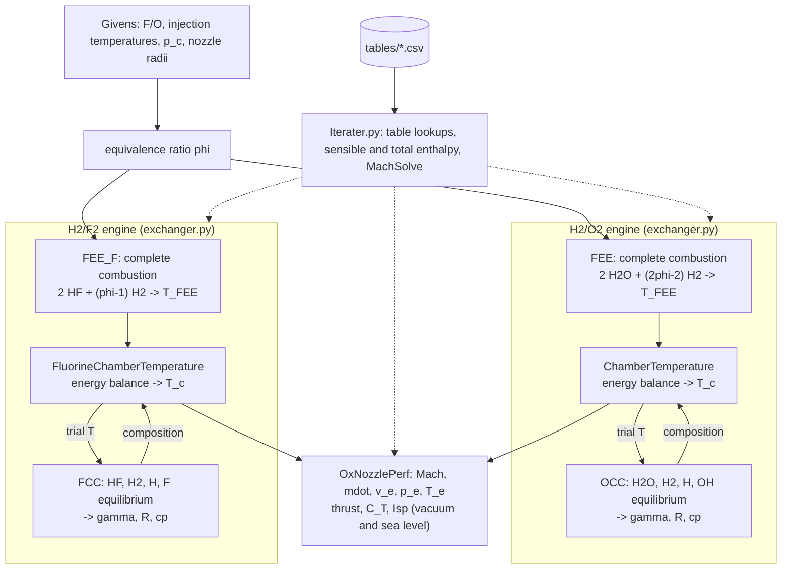

# Space Shuttle Main Engine (SSME) performance model

A performance model of the Space Shuttle Main Engine, built from the course data of Dr. Rodney Bowersox. It finds the chamber temperature and equilibrium gas composition from an energy balance on the propellants, then computes ideal nozzle performance (thrust, thrust coefficient, specific impulse) in vacuum and at sea level. It runs two engines:

- **H₂/O₂**: the SSME itself.
- **H₂/F₂**: the same engine with fluorine as the oxidizer, at the same equivalence ratio, injection temperatures, chamber pressure and nozzle.

**The full write-up, with every equation and the results for both engines, is in [docs/SSME_writeup.md](docs/SSME_writeup.md).**

## Givens

| Combustion chamber | |
|:--|:--|
| Fuel | Hydrogen |
| Oxidizer | O₂ (and F₂ for the fluorine variant) |
| Fuel/oxidizer mass ratio, H₂/O₂ | 0.166 |
| Equivalence ratio φ (both engines) | 1.317 |
| Hydrogen injection temperature | 850 K |
| Oxidizer injection temperature | 530 K |
| Chamber pressure | 204 atm |

| Nozzle geometry | |
|:--|:--|
| Throat radius | 5.15 in |
| Exit radius | 45.35 in (area ratio 77.5) |
| θₚ | 32° (not used by the ideal-nozzle model) |

## Results

| | H₂/O₂ | H₂/F₂ |
|:--|:--:|:--:|
| Complete-combustion temperature | 4617 K | 7107 K |
| Chamber temperature (with dissociation) | 3949 K | 5190 K |
| Mixture molar mass | 13.26 g/mol | 15.43 g/mol |
| γ (frozen) | 1.199 | 1.319 |
| Mass flow | 457.9 kg/s | 445.7 kg/s |
| Vacuum thrust | 2.151 MN | 2.009 MN |
| Vacuum specific impulse | 478.8 s | 459.5 s |
| Sea-level specific impulse | 384.8 s | 362.8 s |

For reference, the real RS-25 is rated at about 2.28 MN and 452 s in vacuum at 109% power. The model sits higher mainly because of the warm injection temperatures in the givens and the loss-free nozzle. The fluorine engine comes out below the oxygen one, even with a hotter chamber, because the nozzle model keeps the composition frozen and never recovers the energy stored in its H and F atoms; see [Fluorine](docs/SSME_writeup.md#fluorine).

## Method

Each engine goes through the same steps (details and equations in the [write-up](docs/SSME_writeup.md)):

1. **First enthalpy exchanger** (`FEE`, `FEE_F`): the temperature reached if the propellants burned completely, with no dissociation. This is an upper bound.
2. **Combustion chamber** (`OCC`, `FCC`): the equilibrium mixture at a given temperature (H₂O, H₂, H, OH for oxygen; HF, H₂, H, F for fluorine), from the atom balances and the law of mass action.
3. **Second enthalpy exchanger** (`ChamberTemperature`, `FluorineChamberTemperature`): the temperature at which the equilibrium mixture carries exactly the propellant enthalpy. Steps 2 and 3 are solved together.
4. **Nozzle** (`OxNozzlePerf`): isentropic expansion with frozen γ to the 77.5 area ratio, giving exit conditions, mass flow, thrust, thrust coefficient and specific impulse.

## Running it

Requires Python 3.11+ (tested on 3.15).

```bash
make setup   # create .venv and install requirements.txt
make         # run the model (SSMEMain.py)
make test    # regression checks
```

`make test` runs `tests/check_regression.py`. It compares the results of both engines with saved values and checks the physics directly: atom and energy balances, equilibrium constants against the Gibbs tables, and the thrust equations.

## Project layout

| Path | Contents |
|:--|:--|
| `SSMEMain.py` | Givens, and the run of both engines |
| `exchanger.py` | Enthalpy exchangers, chamber equilibria, nozzle |
| `Iterater.py` | Thermo table lookups, species enthalpies, Mach-number solver |
| `tables/` | Thermo tables (course data, plus F-atom, HF Gibbs and H to 6000 K from [NIST-JANAF](https://janaf.nist.gov/)) |
| `tests/` | Regression checks |
| `docs/SSME_writeup.md` | Full write-up |

## Code flow


